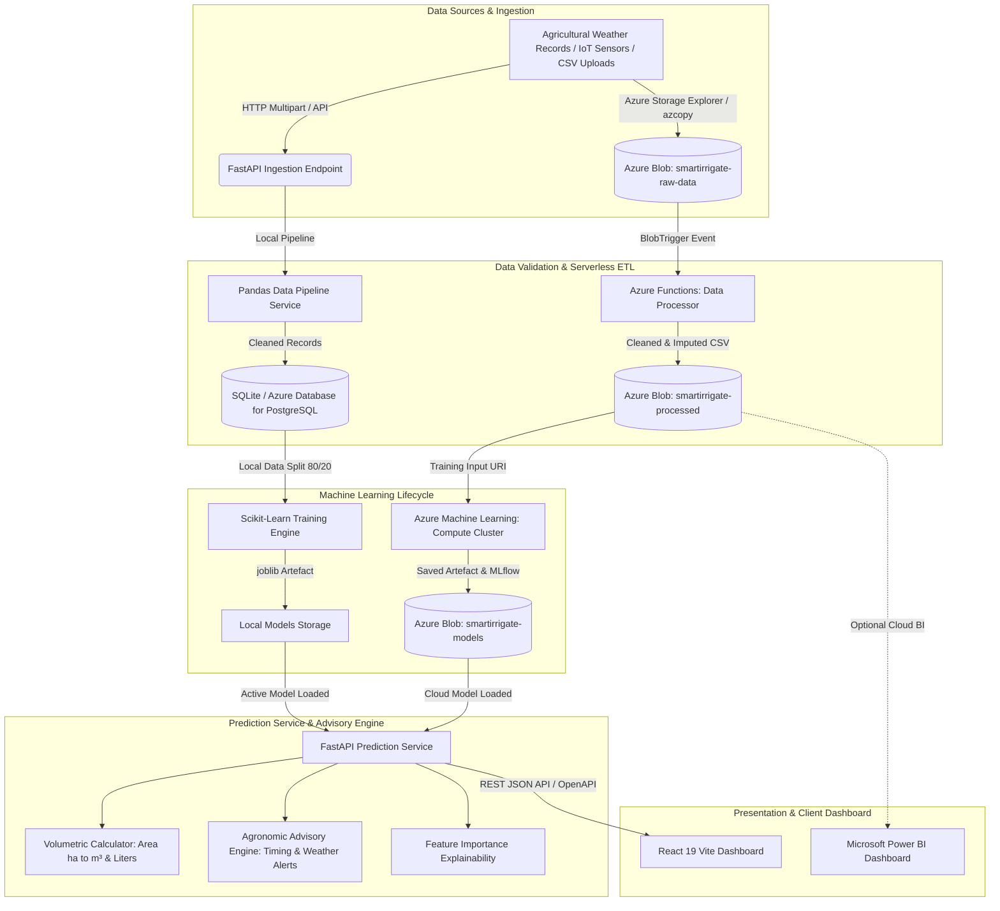
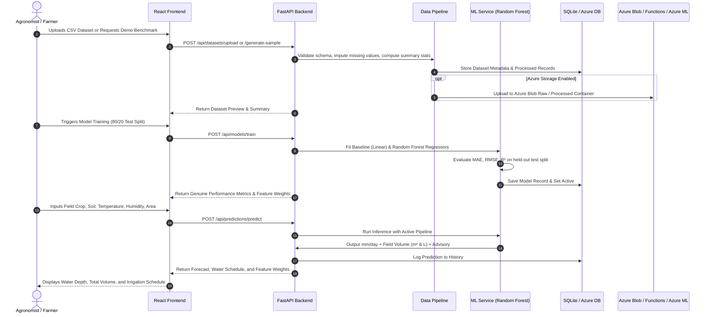

# SmartIrrigate Cloud: System Architecture (Microsoft Azure Cloud)

SmartIrrigate Cloud is an end-to-end cloud-native smart irrigation and crop water demand estimation platform designed to eliminate water wastage and optimize agricultural scheduling.

---

## 1. High-Level Architecture Diagram (Microsoft Azure Cloud)



---

## 2. End-to-End Sequence Diagram



---

## 3. Component Responsibilities

| Component | Technology | Primary Responsibility | Fallback / Local Mode |
| :--- | :--- | :--- | :--- |
| **Frontend Dashboard** | React 19, Vite, TypeScript, Tailwind CSS, Recharts | Interactive UI for irrigation prediction, file uploads, metric visualization, and history export. | Runs locally via Vite (`http://localhost:5173`). |
| **Backend REST API** | Python 3.11/3.13, FastAPI, Uvicorn, Pydantic v2 | Input validation, REST routing, CORS management, error handling, and Swagger docs (`/docs`). | Runs locally via Uvicorn (`http://localhost:8000`). |
| **Data Ingestion Pipeline** | Pandas, NumPy | Schema normalization, missing value imputation (median/mode), duplicate handling, outlier protection. | In-process execution within FastAPI server. |
| **Machine Learning Engine** | Scikit-Learn, Joblib | 80/20 train/test split, baseline comparison (Linear Regression), Random Forest training, test MAE/RMSE/R² calculation. | Local CPU parallelization (`n_jobs=-1`). |
| **Storage Adapter** | Azure Storage Blob SDK / Local FileSystem | Dual-mode storage: stores files locally or mirrors to Azure Blob raw, processed, and model containers. | Seamless fallback to `backend/data_storage/` when Azure is disabled. |
| **Database** | SQLAlchemy, SQLite | Persists dataset schemas, trained model records, and prediction audit history. | SQLite file `smartirrigate.db`; zero cloud cost. |
| **Serverless ETL** | Azure Functions | Event-driven Blob Trigger for automated CSV cleaning upon blob creation in `smartirrigate-raw-data`. | Handled locally by `DataPipeline` service. |
| **Managed Training** | Azure Machine Learning | Managed training jobs on Azure ML compute clusters with MLflow tracking and model registry. | Local Scikit-Learn training engine. |
| **Cloud Dashboard** | Microsoft Power BI | Enterprise BI dashboard for regional watershed managers. | In-app interactive Recharts dashboard. |

---

## 4. Cloud Service Mapping

```
Local Development Mode (Default)          Microsoft Azure Cloud Mode (Config-Driven)
--------------------------------          ------------------------------------------
Local FileSystem (./data_storage)  -----> Azure Blob Storage (Raw, Processed, Models)
FastAPI Internal Pipeline          -----> Azure Functions (BlobTrigger ETL)
Scikit-Learn in-memory training    -----> Azure Machine Learning (Compute Cluster Jobs)
SQLite Database                    -----> Azure Database for PostgreSQL / Cosmos DB
Vite Dev Server (Port 5173)        -----> Azure Static Web Apps + Front Door CDN
In-app Recharts Analytics          -----> Microsoft Power BI Reports & Dashboards
```

---

## 5. Architectural Quality Attributes

1. **Zero Fabrication Principle:** Metrics (MAE, RMSE, $R^2$) are computed on genuine 20% test splits using Scikit-learn functions.
2. **Graceful Degradation:** When Azure credentials are not configured, the platform functions 100% locally with zero errors.
3. **Idempotence & Safety:** Azure Function Blob Triggers verify input paths and write exclusively to downstream containers to prevent infinite event loops.
4. **Least-Privilege Security:** Azure Role-Based Access Control (RBAC) grants `Storage Blob Data Contributor` exclusively where necessary.
