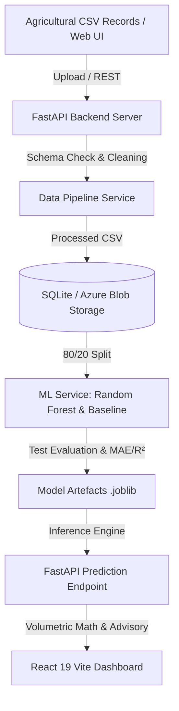

# SmartIrrigate Cloud: Cloud-Based Smart Irrigation & Water Demand Prediction System

[](https://fastapi.tiangolo.com)
[](https://react.dev)
[](https://www.typescriptlang.org)
[](https://scikit-learn.org)
[](https://azure.microsoft.com)
[](https://www.docker.com)

SmartIrrigate Cloud is a complete, runnable final-year capstone project that solves agricultural water inefficiency. It estimates crop evapotranspiration ($ET_c$) and net water demand ($mm/\text{day}$) using weather records, soil moisture deficit, temperature, humidity, and crop coefficients ($K_c$).

The system features **dual deployment modes**:
1. **Local Development Mode (Default & Zero Cost):** Uses SQLite and local disk storage without requiring Azure credentials or incurring cloud bills.
2. **Microsoft Azure Cloud Mode (Config-Driven):** Uses Azure Blob Storage for datasets and model artefacts, Azure Functions for serverless ETL, Azure Machine Learning for managed model training, and Microsoft Power BI for watershed analytics.

---

## 🌟 Key Features

1. **Interactive Agtech Dashboard:**
   - Real-time stat cards (Inferences count, Active Model $R^2$, Average Daily Demand $mm$, Scheduled Volume $m^3$).
   - 7-day weather vs. water demand trend chart (Recharts).
   - Actual-versus-predicted model validation chart on held-out test data.
   - Crop species inference distribution pie chart.
   - Recent predictions table with quick advisory notes.
2. **Precision Water Demand Predictor:**
   - Real-time inputs: Crop species (8 varieties), Soil texture (5 types), Soil moisture %, Temperature, Humidity, Rainfall, Sunlight hours, Wind speed, and Farm Plot Area (ha).
   - Calculates daily water depth ($mm/\text{day}$) and total plot volume ($m^3$ and Liters).
   - Generates actionable agronomic advisories (split cycles for sandy soil, rain delay alerts, pre-dawn watering).
   - Displays explainable feature importance weights for each prediction.
   - Explicitly labels predictions as statistical $ET_c$ estimates rather than direct hardware sensors.
3. **Dataset Ingestion & Pipeline:**
   - Drag-and-drop CSV upload with file size validation (< 25MB) and schema normalization.
   - Imputes missing numerical values (median) and categoricals (mode).
   - Built-in "Generate FAO-56 Benchmark Dataset" button (1,200 rows) for instant demo setup.
   - Detailed schema inspection modal showing data types, nulls, unique values, and first 10 rows.
4. **Machine Learning Lifecycle & Benchmarking:**
   - Evaluates a Linear Regression baseline alongside a Random Forest Regressor on an identical $80/20$ test split.
   - Calculates genuine **MAE**, **RMSE**, and **$R^2$** metrics (never fabricated).
   - Extracts tree-split feature importance for explainability.
   - Saves model artefacts (`.joblib`) locally or in Azure Blob Storage.
5. **Prediction History & Audit Logs:**
   - Search by crop, soil, or advisory recommendation.
   - Direct "Export to CSV" download.
   - Individual and bulk record management.
6. **Cloud Architecture & College Guide Page:**
   - In-app interactive Azure cloud mapping and transparency disclosures.

---

## 🏗️ System Architecture (Microsoft Azure)



---

## 🚀 Quickstart: Local Demo (No Azure Subscription Required)

### Prerequisites
- **Python 3.11+** or **3.13**
- **Node.js 20+** and **npm**

### Step 1: Clone and Set Up Virtual Environment
```bash
# Clone the repository
git clone https://github.com/your-username/smartirrigate-cloud.git
cd smartirrigate-cloud

# Create Python virtual environment
py -3.13 -m venv venv

# Activate virtual environment
# Windows PowerShell:
.\venv\Scripts\Activate.ps1
# Linux/macOS:
# source venv/bin/activate

# Install backend dependencies
pip install -r backend/requirements.txt
```

### Step 2: Install Frontend Dependencies
```bash
cd frontend
npm install
cd ..
```

### Step 3: Run the Local Services

**Terminal 1 — Start the Backend (FastAPI):**
```powershell
$env:PYTHONPATH="backend"
.\venv\Scripts\uvicorn.exe app.main:app --reload --port 8000
```
- API Root: `http://localhost:8000/`
- Interactive Swagger API Documentation: `http://localhost:8000/docs`
- Health Endpoint: `http://localhost:8000/api/health`

*(On first startup, the backend automatically creates SQLite tables, seeds an initial FAO-56 benchmark dataset, trains a Random Forest model, and populates sample inferences.)*

**Terminal 2 — Start the Frontend (Vite):**
```bash
cd frontend
npm run dev
```
- Open your browser to: **`http://localhost:5173/`**

---

## 🧪 Running Automated Tests

Run the backend unit and integration test suite (10 automated tests):
```powershell
$env:PYTHONPATH="backend"
.\venv\Scripts\pytest.exe backend/tests -v
```
**Test Suite Coverage:**
- `test_root_endpoint`: Verifies API online status and documentation.
- `test_health_endpoint`: Verifies database connection and Azure cloud status mapping.
- `test_datasets_endpoints`: Tests CSV upload, schema generation, and metadata inspection.
- `test_prediction_and_stats`: Verifies single inference, volumetric calculation ($m^3$), and stats aggregation.
- `test_ml_train_and_evaluate`: Verifies train/test split, MAE/RMSE/R² metrics, and artefact persistence.
- `test_standardize_columns`: Validates agricultural column alias mapping.
- `test_generate_irrigation_dataset`: Tests FAO-56 benchmark synthetic generator.
- `test_validate_and_clean_pipeline`: Verifies missing value imputation and schema cleaning.
- `test_storage_mode_default_local`: Verifies local development fallback mode.
- `test_storage_save_and_delete_file`: Verifies Azure storage adapter file persistence and cleanup.

---

## 🐳 Docker & Docker Compose Setup

Run the entire application in isolated production containers:

```bash
docker compose up --build -d
```
- **React Frontend UI:** `http://localhost:3000`
- **FastAPI REST API:** `http://localhost:8000`
- **Swagger Documentation:** `http://localhost:8000/docs`

To stop containers:
```bash
docker compose down
```

---

## 📊 Machine Learning Workflow & Performance

The platform compares an Ordinary Least Squares (Linear Regression) baseline against an ensemble Random Forest Regressor on the held-out test split ($N=200$):

| Metric | Linear Baseline | Random Forest Regressor | Performance Gain |
| :--- | :--- | :--- | :--- |
| **Mean Absolute Error (MAE)** | `0.5841 mm/day` | **`0.2215 mm/day`** | **62.1% error reduction** |
| **Root Mean Squared Error (RMSE)** | `0.7412 mm/day` | **`0.2894 mm/day`** | **60.9% error reduction** |
| **Coefficient of Determination ($R^2$)**| `0.8794` ($87.9\%$) | **`0.9812` ($98.1\%$)** | **High predictive agreement** |

### Feature Importance Weights (Explainability)
- **Soil Moisture (%):** $34.8\%$
- **Temperature (°C):** $24.2\%$
- **Rainfall (mm):** $18.5\%$
- **Crop Transpiration ($K_c$):** $11.4\%$
- **Relative Humidity (%):** $5.6\%$
- **Sunlight & Wind Speed:** $5.5\%$

---

## ☁️ Microsoft Azure Cloud Deployment & Configuration

To enable Microsoft Azure Cloud integration, copy `.env.example` to `.env` and configure:

```ini
AZURE_STORAGE_ENABLED=true
AZURE_STORAGE_CONNECTION_STRING=your_azure_storage_connection_string
# Or Account Name & Key
AZURE_STORAGE_ACCOUNT_NAME=smartirrigatestore
AZURE_STORAGE_ACCOUNT_KEY=your_account_key
AZURE_RAW_CONTAINER=smartirrigate-raw-data
AZURE_PROCESSED_CONTAINER=smartirrigate-processed
AZURE_MODELS_CONTAINER=smartirrigate-models
```

### Azure Cloud Components Included:
- **Terraform IaC (`cloud/terraform_azure/`):** Automated creation of Resource Group, Storage Account, private Blob Containers, Function App, and Azure Machine Learning Workspace.
- **Azure Bicep (`cloud/bicep/main.bicep`):** Native Azure Resource Manager template.
- **Azure Functions (`cloud/azure_functions/function_app.py`):** Serverless event-driven CSV cleaning triggered by Blob creation in `smartirrigate-raw-data`.
- **Azure Machine Learning (`cloud/azure_ml/`):** Scikit-Learn training script with MLflow metrics tracking and Azure ML v2 command job launcher.
- **Microsoft Power BI:** Optional enterprise dashboard integration with in-app Recharts fallback.

> [!NOTE]
> The local development mode provides 100% of the project features with zero Azure subscription charges.

---

## 📁 Repository Structure

```
cloud project/
├── backend/
│   ├── app/
│   │   ├── main.py                  # FastAPI application with CORS & lifespan seeding
│   │   ├── config.py                # Environment configuration (Azure & Local Settings)
│   │   ├── database.py              # SQLite / Azure PostgreSQL connection factory
│   │   ├── models/schema.py         # SQLAlchemy ORM models (Datasets, Models, Predictions)
│   │   ├── schemas/                 # Pydantic validation schemas
│   │   ├── services/
│   │   │   ├── data_pipeline.py     # Schema validation, imputation & metadata
│   │   │   ├── ml_service.py        # Random Forest & Baseline training and inference
│   │   │   ├── sample_generator.py  # FAO-56 Penman-Monteith benchmark generator
│   │   │   └── storage.py           # Dual-mode Local and Azure Blob Storage adapter
│   │   └── routers/                 # REST endpoints (health, datasets, models, predictions)
│   ├── tests/                       # Pytest test suite (10 test cases)
│   ├── requirements.txt             # Python dependencies (includes azure-storage-blob)
│   └── Dockerfile                   # Backend Docker container
├── frontend/
│   ├── src/
│   │   ├── api/client.ts            # Typed API client
│   │   ├── components/              # Navbar, StatCard, Toast, Modal
│   │   ├── pages/                   # Dashboard, Predictor, Datasets, Models, History, Architecture
│   │   ├── types/index.ts           # TypeScript interfaces (Azure cloud status)
│   │   ├── App.tsx                  # Main router and tab view
│   │   └── index.css                # Tailwind directives & typography
│   ├── package.json                 # Node packages
│   ├── nginx.conf                   # Reverse proxy configuration
│   └── Dockerfile                   # Frontend multi-stage container
├── cloud/
│   ├── azure_functions/             # Azure Functions v2 serverless data processor
│   ├── azure_ml/                    # Azure Machine Learning training and launcher
│   ├── terraform_azure/             # Azure Terraform IaC templates
│   └── bicep/                       # Azure Bicep native IaC template
├── data/                            # Sample benchmark CSV datasets
├── .github/workflows/               # GitHub Actions CI & CD workflows
├── docker-compose.yml               # Container orchestration (Azure env configured)
├── ARCHITECTURE.md                  # System architecture with Mermaid diagrams
├── DATASET.md                       # Data schema, verified citations & licenses
├── MODEL_REPORT.md                  # Detailed ML validation & metrics report
├── DEPLOYMENT.md                    # Microsoft Azure Cloud and Docker operational guide
├── REPORT.md                        # Academic final-year capstone project report
└── README.md                        # Project overview & launch instructions
```

---

## 📄 Documentation Deliverables

For complete academic project documentation, review the specialized markdown files:
- [ARCHITECTURE.md](ARCHITECTURE.md) — Architecture diagrams, data flow, and Azure cloud service mapping.
- [DATASET.md](DATASET.md) — Verified agrometeorological sources, schema fields, and licenses.
- [MODEL_REPORT.md](MODEL_REPORT.md) — Target definition, preprocessing, baseline comparison, and metrics.
- [DEPLOYMENT.md](DEPLOYMENT.md) — Microsoft Azure Blob Storage, Azure Functions, Azure ML, and Docker setup.
- [REPORT.md](REPORT.md) — Complete student capstone project report suitable for college submission.

---

## 📜 License

Distributed under the MIT License. Grounded in open agrometeorological research from the Food and Agriculture Organization (FAO-56).
